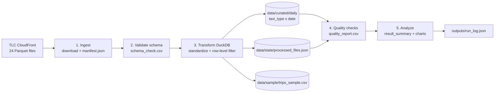

# NYC Taxi — Reproducible Data Pipeline (Submission 2)

**คำถาม:** Which taxi type was the most used in the first half of 2024?
**นิยาม "most used":** ประเภทบริการที่มีจำนวนเที่ยวที่ valid มากที่สุดช่วง 2024-01-01 ถึง 2024-06-30 (วัดความถี่การใช้งาน ไม่ใช่รายได้หรือระยะทาง)

## 1. ข้อมูลที่ใช้
NYC TLC Trip Record Data (Parquet รายเดือน) จาก `https://d37ci6vzurychx.cloudfront.net/trip-data`

| ประเภท | ไฟล์ | คอลัมน์ pickup / dropoff |
|---|---|---|
| Yellow | `yellow_tripdata_YYYY-MM.parquet` | `tpep_pickup_datetime` / `tpep_dropoff_datetime` |
| Green | `green_tripdata_YYYY-MM.parquet` | `lpep_pickup_datetime` / `lpep_dropoff_datetime` |
| FHV | `fhv_tripdata_YYYY-MM.parquet` | `pickup_datetime` / `dropOff_datetime` |
| High Volume FHV | `fhvhv_tripdata_YYYY-MM.parquet` | `pickup_datetime` / `dropoff_datetime` |

รวม 24 ไฟล์ (4 ประเภท x 6 เดือน) แต่ละประเภทมีชื่อคอลัมน์ต่างกัน จึงแปลงเป็น schema กลาง `taxi_type, pickup_datetime, dropoff_datetime, source_file`

## 2. Pipeline / Data Flow



## 3. วิธีติดตั้งและรัน
```bash
python -m venv .venv
.venv\Scripts\Activate.ps1          # Windows PowerShell  (Mac/Linux: source .venv/bin/activate)
pip install -r requirements.txt
python run_pipeline.py              # รันทั้งหมด
python run_pipeline.py --force      # ประมวลผลใหม่ทุกไฟล์
python -m pytest -q                 # รันเทสต์
```
ต้องมีพื้นที่ว่างประมาณ 4 GB สำหรับไฟล์ดิบ (`data/raw/` อยู่ใน .gitignore)

**รันซ้ำ / อัปเดตข้อมูลใหม่:** แก้ `period.end_month` ใน `config.yaml` แล้วรันอีกครั้ง ระบบข้ามไฟล์ที่ดาวน์โหลดและประมวลผลแล้ว (เทียบขนาดไฟล์กับ state) และทำเฉพาะไฟล์ใหม่

## 4. โครงสร้าง repo
```
config.yaml          ค่าตั้งต้นทั้งหมด (ช่วงเวลา ประเภท คอลัมน์ เกณฑ์คุณภาพ)
run_pipeline.py      entry point + เขียน run_log.json
src/ingest.py        ดาวน์โหลด + manifest
src/validate.py      ตรวจ schema และตรวจคุณภาพ
src/transform.py     แปลง/กรอง/เขียน curated
src/analyze.py       ตัวชี้วัด + กราฟ
tests/               เทสต์ข้อมูลจำลอง
data/curated/daily/  curated output (taxi_type x วัน)
data/sample/         ตัวอย่างระดับเที่ยว (1,000 แถวต่อไฟล์)
outputs/             quality_report, result_summary, charts, run_log
```

## 5. การตรวจสอบคุณภาพข้อมูล
ทุกแถวถูกจัดเข้า 1 ใน 4 กลุ่มที่ไม่ซ้อนกัน: `valid`, `null_pickup`, `out_of_period`, `dropoff_before_pickup` (dropoff เป็น NULL ได้ เพราะไฟล์ FHV มักไม่มีค่านี้)

ตรวจต่อไฟล์ (`outputs/quality_report.csv`): (1) ผลรวมกลุ่ม = จำนวนแถวทั้งหมด (2) ผลรวมใน curated daily = จำนวน valid (3) สัดส่วนที่ตัดทิ้งไม่เกินเกณฑ์ WARN/FAIL ใน config ถ้า FAIL pipeline หยุดและ exit code = 1

## 6. หลักฐานการรัน
- `outputs/run_log.json` สถานะและเวลาแต่ละ step, `outputs/run_history.jsonl` ประวัติทุกรอบ
- `data/state/manifest.json` สถานะการดาวน์โหลด, `data/state/processed_files.json` ผลต่อไฟล์
- TODO: ใส่ screenshot terminal รอบแรก (process 24 ไฟล์) และรอบสอง (skip 24 ไฟล์)

## 7. ผลการวิเคราะห์
TODO: วางตารางจาก `outputs/result_summary.csv` และกราฟจาก `outputs/charts/` แล้วอธิบายผล
- ตารางเทียบ baseline กับ curated: `outputs/baseline_vs_curated.csv`
- สรุปคำตอบ 2 นิยาม: ทั้ง 4 บริการ และเฉพาะ Yellow+Green

## 8. Design decisions
1. **ใช้ DuckDB อ่าน Parquet โดยตรง** ข้อมูลกว่า 100 ล้านแถวโหลดเข้า RAM ไม่ได้ DuckDB กรองและนับแบบ streaming ทำให้ตรวจระดับแถวได้ (บนเครื่องที่พัฒนา pandas ถูก Application Control บล็อก การไม่พึ่ง pandas จึงช่วยให้รันได้)
2. **กรองและนับระดับแถวพร้อมบันทึกเหตุผลที่ตัดทิ้ง** แทนการเชื่อ metadata แบบ Submission 1 เพื่อให้ตรวจย้อนกลับได้ว่าแถวไหนถูกตัดเพราะอะไร
3. **Curated output เป็นระดับ taxi_type x วัน** พอสำหรับตอบโจทย์และวิเคราะห์ต่อ ขนาดเล็ก แต่ละระดับเที่ยวเก็บเป็น sample ใน `data/sample/`
4. **รายงานคำตอบ 2 นิยามของ "taxi"** เพราะ FHV/HVFHV ไม่ใช่ taxi ตามกฎหมาย TLC จึงแสดงทั้งสองมุมมอง

## 9. Submission 2 พัฒนาจาก Submission 1 อย่างไร
| | Submission 1 | Submission 2 |
|---|---|---|
| การนับ | จำนวนแถวจาก metadata | กรองระดับแถวด้วย DuckDB พร้อมเหตุผลที่ตัด |
| ผลลัพธ์ | ตารางสรุป 24 แถว | curated parquet + sample + quality report |
| รันซ้ำ | notebook รันใหม่ทั้งหมด | ข้ามไฟล์ที่ทำแล้ว อัปเดตด้วยการแก้ config |
| คุณภาพข้อมูล | ตรวจ schema/ไฟล์ครบ | ตรวจ reconciliation + เกณฑ์ WARN/FAIL ทุกไฟล์ |
| หลักฐาน | output ใน notebook | run_log.json, manifest, state, เทสต์ |

## 10. ข้อจำกัด
- TODO: เติมตามผลจริง เช่น ไม่มี trip ID จึงตรวจแถวซ้ำข้ามไฟล์ไม่ได้, วัดความถี่ ไม่ใช่รายได้/ระยะทาง, FHV มีคุณภาพข้อมูลต่างจากชุดอื่น, ไฟล์ที่ TLC แก้ย้อนหลังด้วยขนาดไฟล์เท่าเดิมจะไม่ถูกตรวจจับ (ใช้ `--force`)

## 11. Learning Reflection
TODO: เขียนเอง 3-5 ประโยค
