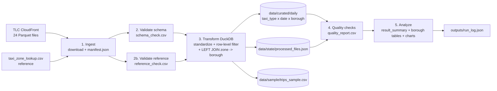
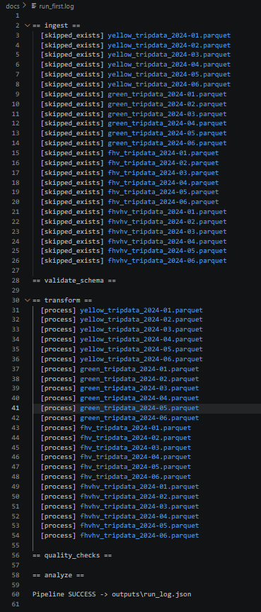
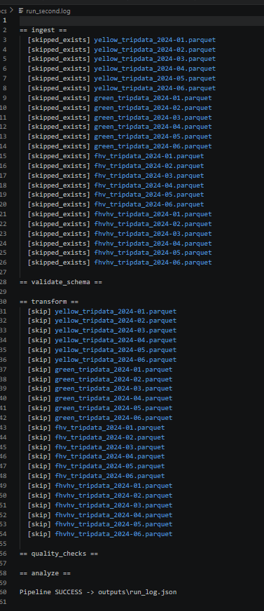
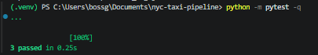
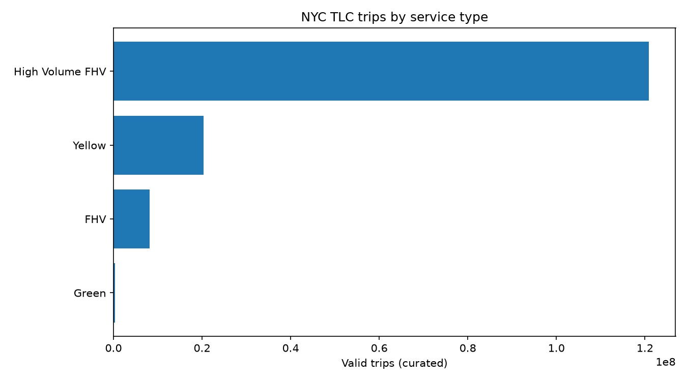
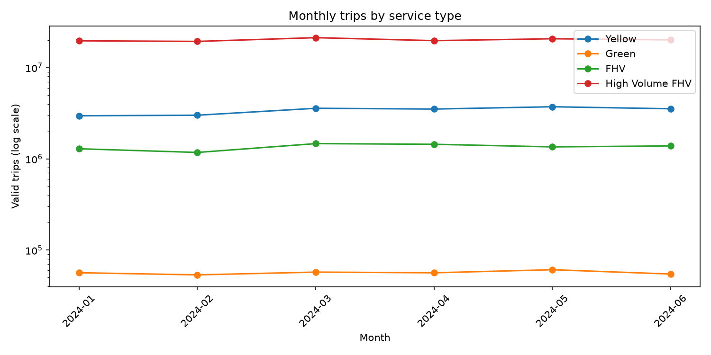
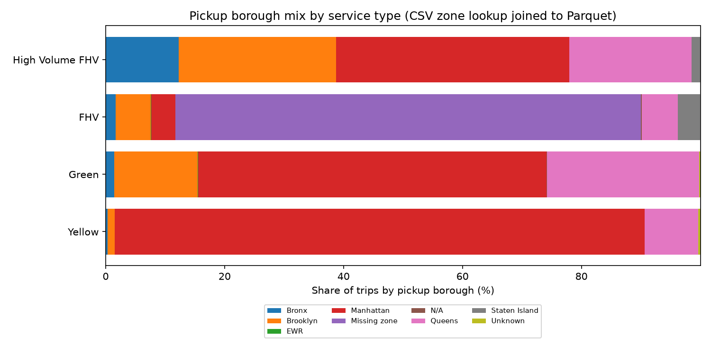

# NYC Taxi — Reproducible Data Pipeline (Submission 2)

**คำถาม:** Which taxi type was the most used in the first half of 2024?

**นิยาม "most used":** ประเภทบริการที่มีจำนวนเที่ยว (trip records) ที่ valid มากที่สุดในช่วง 2024-01-01 ถึง 2024-06-30 (วัดความถี่การใช้งาน ไม่ใช่รายได้ ระยะทาง หรือจำนวนผู้โดยสาร)

**คำตอบ:** **High Volume FHV** — 120,864,668 เที่ยว (80.76%) มากกว่าอันดับสอง (Yellow) ประมาณ 5.9 เท่า ดูรายละเอียดในหัวข้อ 7

---

## 1. ข้อมูลที่ใช้

pipeline นี้รวมข้อมูล **2 รูปแบบไฟล์** จากแหล่งเดียวกัน (NYC TLC) คือ Parquet (ข้อมูลเที่ยว) และ CSV (ตารางอ้างอิงโซน)

### 1.1 ข้อมูลเที่ยว (Parquet) — `https://d37ci6vzurychx.cloudfront.net/trip-data`

| ประเภท | ไฟล์ | คอลัมน์ pickup / dropoff | คอลัมน์รหัสโซนรับ |
|---|---|---|---|
| Yellow | `yellow_tripdata_YYYY-MM.parquet` | `tpep_pickup_datetime` / `tpep_dropoff_datetime` | `PULocationID` |
| Green | `green_tripdata_YYYY-MM.parquet` | `lpep_pickup_datetime` / `lpep_dropoff_datetime` | `PULocationID` |
| FHV | `fhv_tripdata_YYYY-MM.parquet` | `pickup_datetime` / `dropOff_datetime` | `PUlocationID` |
| High Volume FHV | `fhvhv_tripdata_YYYY-MM.parquet` | `pickup_datetime` / `dropoff_datetime` | `PULocationID` |

รวม 24 ไฟล์ (4 ประเภท x 6 เดือน) แต่ละประเภทมีชื่อคอลัมน์ต่างกัน (ตัวพิมพ์ใหญ่เล็กของคอลัมน์โซนก็ต่างกัน) จึงกำหนดผ่าน `config.yaml` แล้วแปลงเป็น schema กลาง `taxi_type, pickup_datetime, dropoff_datetime, pickup_location_id, pickup_borough, source_file`

### 1.2 ข้อมูลอ้างอิง (CSV) — `https://d37ci6vzurychx.cloudfront.net/misc/taxi_zone_lookup.csv`

ตาราง `taxi_zone_lookup.csv` (คอลัมน์ `LocationID, Borough, Zone, service_zone`) ใช้แปลงรหัสโซนรับผู้โดยสารเป็นชื่อเขต (borough) เก็บไว้ใน `data/reference/` (ไฟล์เล็ก เก็บใน repo)

**การบูรณาการ:** ไฟล์เที่ยว (Parquet) join กับตารางโซน (CSV) ด้วย `pickup_location_id = LocationID` เพื่อเพิ่มมิติ "เขตที่รับผู้โดยสาร" ให้ทั้ง 4 ประเภทเปรียบเทียบกันได้

## 2. Pipeline / Data Flow



## 3. วิธีติดตั้งและรัน

```bash
python -m venv .venv
.venv\Scripts\Activate.ps1          # Windows PowerShell  (Mac/Linux: source .venv/bin/activate)
pip install -r requirements.txt
python run_pipeline.py              # รันทั้งหมด
python run_pipeline.py --force      # ประมวลผลใหม่ทุกไฟล์ (ไม่ใช้ state เดิม)
python -m pytest -q                 # รันเทสต์
```

ต้องมีพื้นที่ว่างประมาณ 4 GB สำหรับไฟล์ดิบ (`data/raw/` อยู่ใน `.gitignore`)

**รันซ้ำ / อัปเดตข้อมูลใหม่:** แก้ `period.end_month` ใน `config.yaml` (เช่น เป็น `2024-07`) แล้วรันอีกครั้ง ระบบจะข้ามไฟล์ที่ดาวน์โหลดและประมวลผลแล้ว (เทียบขนาดไฟล์และเวอร์ชัน schema กับ state) และทำเฉพาะไฟล์ใหม่

## 4. โครงสร้าง repo

```
config.yaml           ค่าตั้งต้นทั้งหมด (ช่วงเวลา ประเภท คอลัมน์ ไฟล์อ้างอิง เกณฑ์คุณภาพ)
run_pipeline.py       entry point + เขียน run_log.json
requirements.txt      ไลบรารีที่ใช้
src/ingest.py         ดาวน์โหลด Parquet + CSV และบันทึก manifest
src/validate.py       ตรวจ schema, ตรวจไฟล์อ้างอิง, ตรวจคุณภาพ
src/transform.py      แปลง/กรอง/join โซน/เขียน curated
src/analyze.py        ตัวชี้วัด + ผลแยกตามเขต + กราฟ
tests/                เทสต์ด้วยข้อมูลจำลอง
data/reference/       taxi_zone_lookup.csv (ไฟล์อ้างอิง CSV)
data/curated/daily/   curated output (taxi_type x วัน x เขตรับผู้โดยสาร) เป็น Parquet
data/sample/          ตัวอย่างระดับเที่ยว (สูงสุด 1,000 แถวต่อไฟล์)
data/state/           manifest.json และ processed_files.json (สถานะการทำงาน)
outputs/              quality_report, result_summary, borough tables, charts, run_log
docs/                 หลักฐานการรัน (log และภาพหน้าจอ)
submission1/          notebook ของ Submission 1 (baseline)
```

## 5. การตรวจสอบคุณภาพข้อมูล

ทุกแถวถูกจัดเข้า 1 ใน 4 กลุ่มที่ไม่ซ้อนกัน: `valid`, `null_pickup`, `out_of_period`, `dropoff_before_pickup` (dropoff เป็น NULL ได้ เพราะไฟล์ FHV มักไม่มีค่านี้ และไม่จำเป็นต่อการนับจำนวนเที่ยว)

ตรวจต่อไฟล์ (`outputs/quality_report.csv`):

1. ผลรวมของ 4 กลุ่ม = จำนวนแถวทั้งหมดของไฟล์
2. ผลรวมใน curated daily (หลัง join โซน) = จำนวนแถว valid เพื่อยืนยันว่า join ไม่ทำให้แถวเพิ่มหรือหาย
3. สัดส่วนที่ถูกตัดทิ้งไม่เกินเกณฑ์ WARN (2%) / FAIL (20%) ใน `config.yaml` ถ้า FAIL pipeline หยุดและ exit code = 1

**การตรวจไฟล์อ้างอิง (`outputs/reference_check.csv`):** คอลัมน์ครบ และ `LocationID` ต้องไม่ซ้ำ (ถ้าซ้ำ การ join จะทำให้จำนวนเที่ยวเพิ่มเกินจริง)

**การ join โซน:** ใช้ LEFT JOIN แถวที่ไม่มีรหัสโซนถูกจัดเป็น `Missing zone` และรหัสที่ไม่อยู่ใน lookup เป็น `Unmatched ID` สัดส่วนต่อไฟล์อยู่ที่คอลัมน์ `zone_missing_pct` และ `zone_unmatched_rows`

**ผลการตรวจ (จากการรันบนข้อมูลจริง):**

- TODO: เติมจำนวนไฟล์ PASS / WARN / FAIL จาก `status` ใน `outputs/quality_report.csv` (รอบก่อนเพิ่ม zone join ได้ PASS 24 / WARN 0 / FAIL 0)
- แถวที่ถูกตัดทิ้งมีเฉพาะ Yellow และ Green:

| ประเภท | แถวทั้งหมด | นอกช่วงเวลา | dropoff ก่อน pickup | รวมที่ตัด | % ที่ตัด |
|---|---:|---:|---:|---:|---:|
| Yellow | 20,332,093 | 39 | 300 | 339 | 0.0017% |
| Green | 339,807 | 6 | 0 | 6 | 0.0018% |
| FHV | 8,119,228 | 0 | 0 | 0 | 0% |
| High Volume FHV | 120,864,668 | 0 | 0 | 0 | 0% |

- ไม่พบแถวที่ pickup เป็น NULL ในทุกไฟล์
- พบแถวที่ pickup อยู่ในช่วงที่วิเคราะห์ แต่ไม่ตรงกับเดือนของชื่อไฟล์ (Yellow 110 แถว, Green 38 แถว) ซึ่งยังนับรวมไว้ เพราะตัวชี้วัดใช้วันที่ pickup จริง ไม่ใช่ชื่อไฟล์
- TODO: เปิดคอลัมน์ `zone_missing_pct` ใน `quality_report.csv` แล้วเขียนว่าประเภทใดมีรหัสโซนว่างกี่ % (คาดว่า FHV สูงกว่าประเภทอื่น)

## 6. หลักฐานการรัน

- `outputs/run_log.json` สถานะและเวลาของแต่ละ step, `outputs/run_history.jsonl` ประวัติทุกรอบที่รัน
- `data/state/manifest.json` สถานะการดาวน์โหลดแต่ละไฟล์ (ทั้ง Parquet และ CSV), `data/state/processed_files.json` ผลการประมวลผลต่อไฟล์
- `docs/run_first.log` และ `docs/run_second.log` log เต็มของสองรอบ

**รอบแรก** (ประมวลผลทุกไฟล์ใหม่):



**รอบสอง** (`python run_pipeline.py` ข้ามทุกไฟล์ที่ทำแล้ว แสดงว่ารันซ้ำได้ ผลลัพธ์เท่าเดิม):



**เทสต์ (3 ข้อ):**



## 7. ผลการวิเคราะห์

### คำตอบ

**High Volume FHV คือประเภทที่ถูกใช้มากที่สุดในครึ่งแรกของปี 2024** ด้วย 120,864,668 เที่ยว (80.76%) มากกว่าอันดับสอง (Yellow) ประมาณ 5.9 เท่า

| นิยาม | อันดับ | ประเภท | เที่ยว | สัดส่วน |
|---|---:|---|---:|---:|
| ทั้ง 4 บริการ | 1 | High Volume FHV | 120,864,668 | 80.76% |
| | 2 | Yellow | 20,331,754 | 13.59% |
| | 3 | FHV | 8,119,228 | 5.43% |
| | 4 | Green | 339,801 | 0.23% |
| เฉพาะ Yellow + Green | 1 | Yellow | 20,331,754 | 98.36% |
| | 2 | Green | 339,801 | 1.64% |

ที่มาของตัวเลข: `outputs/result_summary.csv` (คำนวณจาก `data/curated/daily/*.parquet` ด้วย `src/analyze.py`)





### มุมมองเพิ่มเติม: เขตที่รับผู้โดยสาร (ผลจากการ join CSV + Parquet)

TODO: วางตารางจาก `outputs/most_used_by_borough.csv` แล้วอธิบาย 2-3 ประโยค (ประเภทใดใช้มากที่สุดในแต่ละเขต)
ข้อมูลเต็มอยู่ที่ `outputs/trips_by_borough.csv`



ผลรวมรายเขตของแต่ละประเภทตรวจแล้วว่าเท่ากับยอดรวมของประเภทนั้น (reconcile ใน `src/analyze.py`) คำตอบหลักไม่เปลี่ยน เพราะการ join เป็นการเพิ่มมิติ ไม่ได้กรองแถว

### ความหมายของผล

- **ผู้ชนะไม่เปลี่ยนหลังทำความสะอาดข้อมูลระดับแถว** เมื่อเทียบกับ baseline (`outputs/baseline_vs_curated.csv`) แสดงว่าข้อสรุปค่อนข้างทนต่อปัญหาคุณภาพข้อมูลที่พบ
- **คำตอบขึ้นกับนิยามของ "taxi":** ถ้านับรวมบริการ for-hire ทั้งหมด (รวม High Volume FHV ซึ่งเป็นบริการแบบแอปเรียกรถ) ผู้ชนะคือ High Volume FHV แต่ถ้านับเฉพาะแท็กซี่ที่ TLC กำกับโดยตรง (Yellow, Green) ผู้ชนะคือ Yellow
- "most used" ในที่นี้วัดจากจำนวนเที่ยวที่บันทึก ไม่ใช่จำนวนผู้โดยสารที่ไม่ซ้ำ รายได้ หรือระยะทาง

## 8. Design decisions

1. **ใช้ DuckDB อ่าน Parquet โดยตรง แทน pandas** ข้อมูลรวมกว่า 149 ล้านแถวโหลดเข้า RAM ทั้งหมดไม่ได้ DuckDB กรองและนับแบบ streaming จึงตรวจได้ระดับแถว นอกจากนี้ บนเครื่องที่พัฒนา pandas และ pyarrow ถูก Application Control ของ Windows บล็อก การไม่พึ่งไลบรารีเหล่านี้จึงทำให้ pipeline รันได้จริง
2. **กรองและนับระดับแถว พร้อมบันทึกเหตุผลที่ตัดทิ้ง** แทนการเชื่อจำนวนแถวจาก metadata แบบ Submission 1 ทุกแถวถูกจัดเข้ากลุ่มที่ไม่ซ้อนกัน จึงตรวจย้อนกลับได้ว่าแถวไหนถูกตัดเพราะอะไร และผลรวมต้องเท่ากับแถวทั้งหมด
3. **Curated output เป็นระดับ taxi_type x วัน x เขต** เพียงพอต่อการตอบโจทย์และการวิเคราะห์แนวโน้ม ขนาดเล็กพอเก็บใน repo ได้ ส่วนข้อมูลระดับเที่ยวเก็บเป็นตัวอย่างใน `data/sample/` แทนการเก็บทั้งหมดซึ่งมีหลายร้อยล้านแถว
4. **ไม่ตัดแถวที่ dropoff เป็น NULL และรายงานคำตอบ 2 นิยามของ "taxi"** ไฟล์ FHV มักไม่มีค่า dropoff และค่านี้ไม่จำเป็นต่อการนับเที่ยว ส่วน FHV/High Volume FHV ไม่ใช่ taxi ตามนิยามของ TLC จึงแสดงทั้งมุมมอง "ทุกบริการ" และ "เฉพาะ Yellow+Green"
5. **บันทึกสถานะรายไฟล์ (idempotent)** ถ้าล้มกลางทาง รันใหม่แล้วทำต่อจากไฟล์ที่ค้างได้ เพิ่มเดือนใหม่ได้โดยแก้ config และเมื่อ schema ของ output เปลี่ยน (เพิ่มคอลัมน์โซน) ระบบประมวลผลใหม่เองผ่านเลขเวอร์ชันใน state
6. **ใช้ LEFT JOIN และติดป้ายแถวที่จับคู่ไม่ได้ แทน INNER JOIN** INNER JOIN จะทำให้เที่ยวที่ไม่มีรหัสโซน (พบมากใน FHV) หายไปจากยอดรวมและทำให้ตัวชี้วัดหลักผิด จึงเก็บทุกแถวและติดป้าย `Missing zone`/`Unmatched ID` พร้อมตรวจว่า `LocationID` ใน lookup ไม่ซ้ำ เพื่อไม่ให้จำนวนเที่ยวเพิ่มเกินจริง

## 9. Submission 2 พัฒนาจาก Submission 1 อย่างไร

| | Submission 1 (`submission1/`) | Submission 2 |
|---|---|---|
| รูปแบบข้อมูล | Parquet อย่างเดียว | Parquet (เที่ยว) + CSV (zone lookup) join กันด้วยรหัสโซน |
| การนับ | จำนวนแถวจาก metadata ของ Parquet | กรองระดับแถวด้วย DuckDB พร้อมเหตุผลที่ตัด |
| ผลลัพธ์ | ตารางสรุป 24 แถวในหน่วยความจำ | curated Parquet + sample + quality report + ผลแยกเขต |
| รันซ้ำ | รัน notebook ใหม่ทั้งหมด | ข้ามไฟล์ที่ทำแล้ว อัปเดตด้วยการแก้ config |
| คุณภาพข้อมูล | ตรวจ schema/ไฟล์ครบ ตรวจ datetime จาก sample | ตรวจ reconciliation + ตรวจไฟล์อ้างอิง + เกณฑ์ WARN/FAIL ทุกไฟล์ |
| หลักฐาน | output ใน notebook | run_log.json, manifest, state, เทสต์ |

**ผลเปรียบเทียบ** (`outputs/baseline_vs_curated.csv`):

| ประเภท | baseline (S1) | curated (S2) | ต่าง |
|---|---:|---:|---:|
| Yellow | 20,332,093 | 20,331,754 | 339 |
| Green | 339,807 | 339,801 | 6 |
| FHV | 8,119,228 | 8,119,228 | 0 |
| High Volume FHV | 120,864,668 | 120,864,668 | 0 |
| **รวม** | **149,655,796** | **149,655,451** | **345 (0.00023%)** |

Baseline นับเกินจากแถวที่ผิดปกติ 345 แถว อันดับและผู้ชนะไม่เปลี่ยน แต่ตัวเลขของ Submission 2 ตรวจสอบย้อนกลับได้ว่าแถวใดถูกตัดเพราะเหตุใด

## 10. ข้อจำกัด

1. **ตรวจคุณภาพเฉพาะฟิลด์วันเวลาและรหัสโซน** ไม่ได้ตรวจ fare ระยะทาง จำนวนผู้โดยสาร หรือพิกัด การที่ FHV และ High Volume FHV ไม่มีแถวถูกตัดหมายถึงตรวจเรื่องเวลาแล้วไม่พบปัญหา ไม่ได้ยืนยันว่าข้อมูลสมบูรณ์ทุกด้าน
2. **ตรวจแถวซ้ำไม่ได้** เพราะไม่มี trip ID ที่ใช้ร่วมกันทุกประเภท จึงถือว่า 1 แถว = 1 เที่ยว
3. **เปรียบเทียบบริการที่ต่างกัน** Yellow/Green เป็นแท็กซี่ ส่วน FHV/High Volume FHV เป็นบริการ for-hire ผลจึงขึ้นกับนิยาม (จึงรายงานทั้ง 2 นิยาม)
4. **จำนวนเที่ยว ≠ ผู้ใช้ไม่ซ้ำ** และไม่ถ่วงน้ำหนักด้วยระยะทางหรือรายได้
5. **การวิเคราะห์เขตใช้เฉพาะโซนรับผู้โดยสาร (pickup)** ไม่ได้วิเคราะห์โซนส่ง และไฟล์ FHV อาจมีรหัสโซนว่างเป็นสัดส่วนสูง ผลแยกเขตของ FHV จึงมีสัดส่วน `Missing zone` มาก
6. **แหล่งข้อมูลยังเป็นแหล่งเดียว** ทั้ง Parquet และ CSV มาจาก TLC ยังไม่ได้รวมข้อมูลจากแหล่งภายนอกอื่น เช่น สภาพอากาศ
7. **การตรวจว่าไฟล์เปลี่ยนใช้ขนาดไฟล์** ถ้า TLC แก้ไฟล์ย้อนหลังแต่ขนาดเท่าเดิม pipeline จะไม่ตรวจพบ (ใช้ `--force` เพื่อประมวลผลใหม่)
8. **พึ่งแหล่งข้อมูลภายนอก** ถ้า URL ต้นทางเปลี่ยนหรือหายไป การรันใหม่อาจให้ผลต่างจากเดิม และเกณฑ์ WARN/FAIL ตั้งจากการประเมินเบื้องต้น ไม่ได้อิงมาตรฐานทางการ

## 11. Learning Reflection

รอบแรกผมเชื่อจำนวนแถวจาก metadata แต่พอได้ตรวจข้อมูลจริงในรอบนี้ ก็พบว่ามีแถวผิดปกติ 345 แถวที่ถูกนับรวมอยู่ แต่ไม่ได้ระบุว่าเป็นข้อมูลผิดปกติ ถึงแม้จะไม่ส่งผลต่ออันดับสุดท้าย แต่ทำให้ผมเห็นว่าการตรวจข้อมูลจริงและสามารถอธิบายที่มาของตัวเลขได้เป็นเรื่องสำคัญ ผมจึงจัดกลุ่มข้อมูลทุกแถวไว้ เพื่อให้สามารถย้อนกลับไปตรวจสอบได้

นอกจากนี้ การนำไฟล์ CSV มารวมกับ Parquet ทำให้ผมได้เรียนรู้ว่าควรใช้ LEFT JOIN และตรวจสอบว่าคีย์ไม่มีข้อมูลซ้ำ เพื่อป้องกันจำนวนเที่ยวที่คลาดเคลื่อน ผมยังได้เรียนรู้ว่า pipeline ที่ดีควรสามารถรันซ้ำได้และมีหลักฐานแสดงสถานะการทำงาน รวมถึงต้องปรับวิธีทำงานให้เหมาะกับข้อจำกัดของเครื่องมือด้วย เช่น เมื่อ Windows บล็อกการใช้งาน pandas และ pyarrow ผมจึงเปลี่ยนมาใช้ DuckDB แทนจนสามารถทำงานต่อได้สำเร็จ